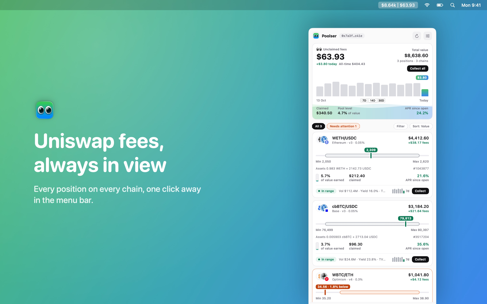
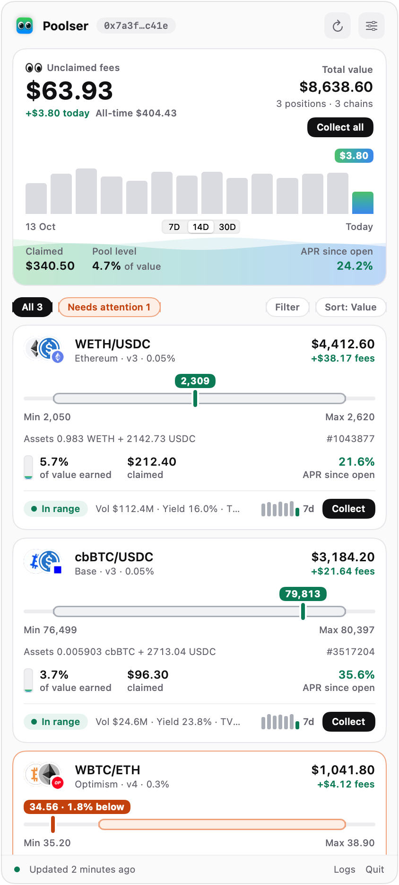
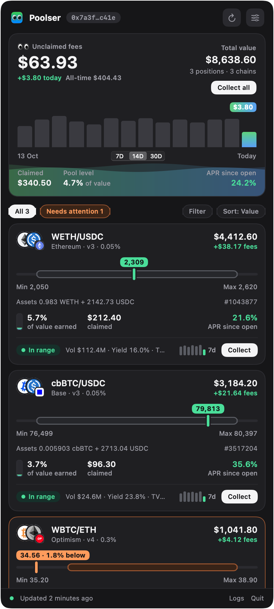
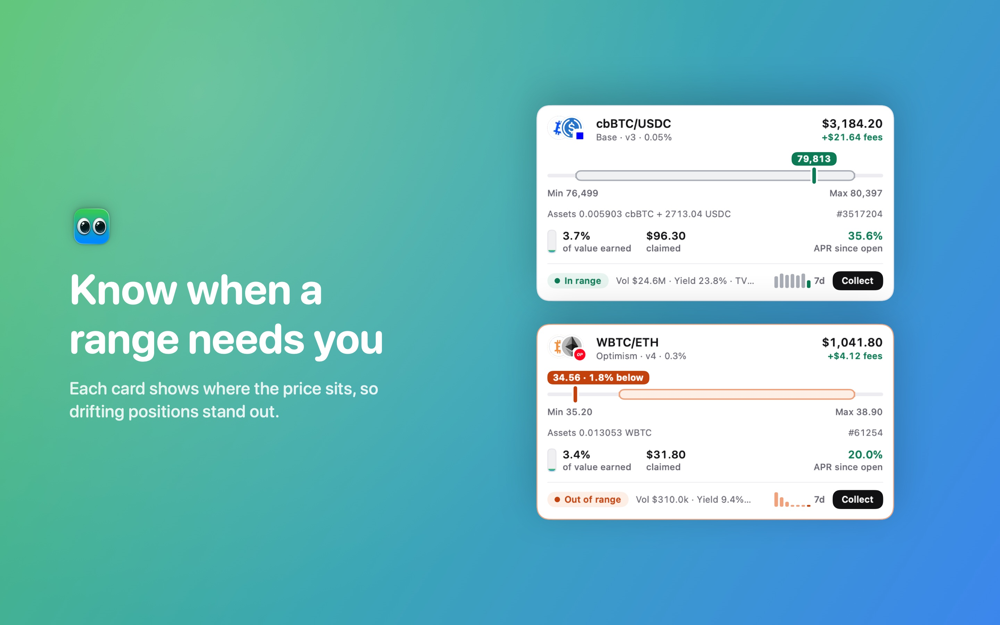
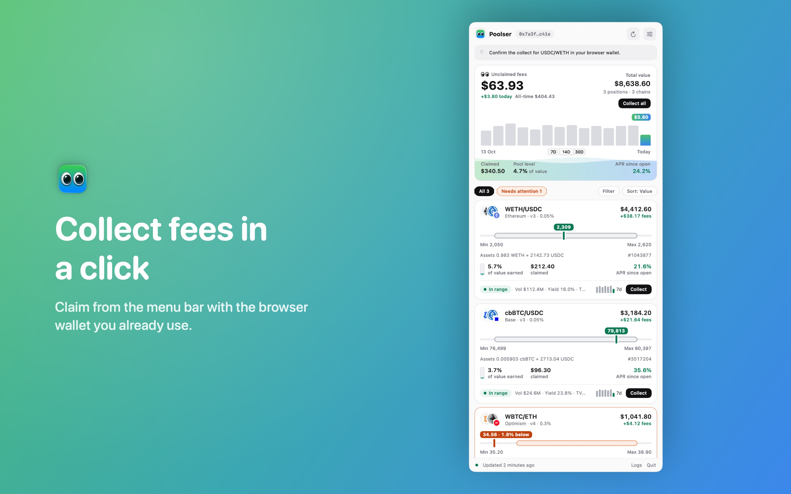

# 👀 Poolser

Your Uniswap v3 and v4 positions in the macOS menu bar.

Poolser shows your total value and unclaimed fees at a glance, flags the ranges that need attention, and lets you collect fees with your browser wallet. It reads everything straight from the chain through your own Infura key: no account, no indexer, no tracking.

[Download on the Mac App Store](https://apps.apple.com/app/poolser/id6762252798)



> **Disclaimer:** This is an independent hobby project with no affiliation, association, or connection to Uniswap Labs or the Uniswap Protocol. "Uniswap" is a trademark of Uniswap Labs.

---

## Features

### At a glance

- Total value and unclaimed fees in the menu bar (`$8.64k │ $63.93`), refreshed every 10 minutes by default and on demand
- A summary card with unclaimed fees, total value, today's fees and all-time fees
- A daily fee chart for the last 7, 14 or 30 days. For v3 positions it is read from on-chain history, so it is full from the first launch; v4 positions are recorded from each refresh
- Claimed fees, the share of value earned back in fees ("pool level") and APR since you opened each position

### Position cards

- A range gauge with the current price and Min and Max shown as prices, not ticks
- Status: in range, near the edge (within 3% of a bound), out of range (with how far the price has moved) or full range
- Current token amounts, position ID, pool volume, TVL and 24h yield
- Token logos (DefiLlama) and chain badges (CoinGecko), cached locally
- A 7-day fee bar chart per position
- Filter by chain, by version or by positions that need attention; sort by value, unclaimed fees, 24h yield or pair
- Right-click to open the position on app.uniswap.org or copy its position ID or pool

### Collect fees

- Collect one position, or every position on a chain at once (one transaction per Uniswap version, batched when the wallet supports EIP-5792)
- Poolser dry-runs the transaction, then opens a local page in your default browser that hands it to your wallet extension (MetaMask, Rabby and others) to confirm and sign
- Poolser never sees your keys and never signs anything; see [PRIVACY.md](PRIVACY.md)

### Chains

| Network | v3 | v4 |
|---|---|---|
| Ethereum, Base, Arbitrum, Optimism, Polygon, Blast, Unichain | ✓ | ✓ |
| Avalanche, BNB Chain, Celo, zkSync, Monad, MegaETH | ✓ | |

All networks go through Infura endpoints derived from one API key. Networks your Infura project cannot access are turned off automatically.

### Optional

- **Range change notifications:** a macOS notification when a position moves in or out of range (*Settings → Range Change Notifications*, off by default)
- **Claimed fee history:** scans on-chain `Collect` events for each v3 position (*Settings → Track Claimed Fees*, off by default). It makes many `eth_getLogs` requests and can be request-heavy on fast-block chains like Base or Arbitrum; results are cached and only new blocks are scanned afterwards
- **Flash on value change:** the menu bar title blinks with 🔼 or 🔽 when unclaimed fees change after a refresh
- **Launch at Login**
- **Logs:** every RPC request, response, retry and error, from the popover footer

### Under the hood

- Per-position contract reads batched with Multicall3; token prices cached briefly and shared between requests
- A credit-based request limiter that backs off automatically after HTTP 429s
- Incremental v4 ownership discovery from `Transfer` logs: the first scan is chunked and resumable, later refreshes only scan new blocks
- Native SwiftUI, no dependencies, no web views (the collect page opens in your own browser)

## Screenshots

 





Settings and logs:

 

The App Store screenshots and the popover images are rendered from the app's own views with a demo wallet. To make them again after a UI change:

```bash
POOLSER_SCREENSHOTS=docs/screenshots swift run
```

The debug build writes the images and quits. Captions live in `Sources/Poolser/Graphite/StoreScreenshots.swift`; the listing text is in [docs/app-store.md](docs/app-store.md).

## Requirements

- macOS 14 (Sonoma) or later
- An [Infura](https://infura.io) API key
- One or more wallet addresses that hold Uniswap v3 or v4 positions

## Building

The project uses Swift Package Manager with no external dependencies.

```bash
git clone https://github.com/GoranStoyanov/Poolser.git
cd Poolser
swift build -c release
```

To run directly:

```bash
swift run
```

To run the unit tests:

```bash
swift test
```

To open in Xcode:

```bash
open Package.swift
```

## Pre-Commit Secret Scan (gitleaks)

This repo includes a pre-commit hook that scans staged changes for secrets.

1. Install gitleaks:

```bash
brew install gitleaks
```

2. Enable repo-managed hooks once:

```bash
git config core.hooksPath .githooks
chmod +x .githooks/pre-commit
```

After setup, each commit runs gitleaks on staged changes and blocks the commit if a secret is detected.

## Configuration

Open **Settings** (gear icon in the popup, or `⌘,`) and configure:

| Field | Description |
|---|---|
| Wallet Addresses | Save Ethereum addresses (`0x…`) and choose the active wallet |
| Infura API Key | The API key only (no full URL needed) |
| Enabled Networks | Toggle supported Infura networks on/off |
| Refresh Interval | Auto-refresh period |
| RPC Credit Budget | Local pacing budget for RPC calls |
| v4 Log Settings | Chunk size/concurrency/bootstrap controls for v4 log scans |

Important behavior:
- Setting edits are draft-only until you press **Save & Refresh**
- Switch between saved wallets from the address menu in the portfolio header
- Closing settings with `X`/`Esc` discards unsaved changes
- Settings are saved in `UserDefaults`; the Infura API key is saved in the macOS Keychain
- Some Infura networks are gated per project; enable the network in your Infura dashboard first if needed

## How Position Discovery Works

### v3
- Uses `balanceOf(owner)` on the v3 `NonfungiblePositionManager`
- Enumerates token IDs via `tokenOfOwnerByIndex`
- Loads per-position details via `positions(tokenId)`

### v4
- Uses `balanceOf(owner)` on the v4 `PositionManager`
- Reconstructs ownership from `Transfer` logs (v4 PM is not ERC-721 Enumerable)
- Persists a local ownership cache in `UserDefaults`:
  - last scanned block
  - candidate token IDs
  - currently owned token IDs
- next bootstrap cursor block (`nextBootstrapFromBlock`) for resume
- First-time bootstrap progresses in chunks and resumes from cache until caught up
- While bootstrap is active, Poolser schedules accelerated per-chain follow-up refreshes (without changing the normal global refresh interval)

## RPC Rate Limiting Notes

Poolser includes built-in pacing to reduce `HTTP 429` rate-limit errors:

- Credit-aware request limiter (safe margin for constrained plans)
- Reduced `eth_getLogs` concurrency/chunk pressure
- Retry logic for transient/null/malformed responses

If your provider still rate-limits frequently:

1. Increase the refresh interval and avoid rapid manual refresh spam.
2. Use a higher-throughput Infura plan.
3. Prefer reliable archival/log-capable endpoints for heavy `eth_getLogs` workloads.

## Troubleshooting

- `RPC: HTTP 429`
  - Your RPC provider is throttling requests. See the rate-limiting section above.

- `v4: bootstrap scan in progress (auto-refresh in ~Xs from 0x...)`
  - Expected on first sync for wallets with long history. `0x...` is the next resume block and `~Xs` is a live countdown.

- `v4: bootstrap refresh in progress (from 0x...)`
  - Countdown reached zero and the accelerated follow-up refresh is currently running for that chain.

- `v4: no Transfer events found for this wallet (balance=N)`
  - Usually indicates incomplete log coverage from the RPC provider, or bootstrap not completed yet.

- Intermittent `no result` / bad JSON in logs
  - Usually provider instability. The app retries automatically, but a more reliable endpoint helps.

- A network you enabled disappears from selection after refresh
  - Your Infura project likely has no access to that network yet. Enable it in the Infura dashboard for your API key, then re-enable it in Settings.
  - Poolser auto-disables networks that return Infura access-denied responses.

## Privacy

Poolser communicates only with:

- Infura RPC endpoints derived from your API key (on-chain reads, and gas estimates before a collect)
- [CoinGecko](https://coingecko.com) and [DefiLlama](https://defillama.com) public APIs (token USD prices, token logos and chain icons)
- [GeckoTerminal](https://geckoterminal.com) (pool volume, TVL and yield)
- A temporary server on `127.0.0.1` and your own browser, only while you collect fees

No analytics and no tracking. Details are in [PRIVACY.md](PRIVACY.md).

## License

MIT. See [LICENSE](LICENSE).
